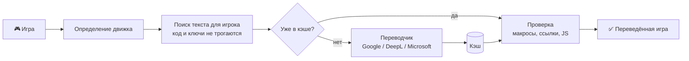

<div align="center">

# 🌐 RUT

**Машинный перевод игр одной командой**<br>
SugarCube 2 (Twine) · Ren'Py · Godot 4 · а на лету — любые игры на HTML/JavaScript

[](https://www.python.org/downloads/)
[](RUT-v0.17.py)
[](requirements.txt)
[](https://github.com/Slavatar2001/RUT/actions/workflows/check.yml)
<br>


[Быстрый старт](#быстрый-старт) ·
[Какие игры](#какие-игры-поддерживаются) ·
[Режимы](#режимы-работы) ·
[Примеры](#примеры) ·
[Все флаги](#все-флаги) ·
[Вопросы](#частые-вопросы)

</div>

---

**RUT** — это один Python-файл, который не нужно устанавливать. Укажите ему игру — он сам определит
движок, найдёт текст для игрока, переведёт его через Google Translate (бесплатно, без ключа) или через
DeepL / Microsoft / Google Cloud по ключу и соберёт переведённую игру. Код, переменные и логика игры
при этом не ломаются, а всё переведённое запоминается: прерванный перевод продолжается с того же места
и не тратит лимиты повторно.

## Возможности

- 🔍 **Сам определяет движок** — достаточно указать файл или папку игры, её `.exe`, `.pck` или распакованный APK.
- 🛡️ **Не ломает игру** — переводится только текст, который видит игрок; имена пассажей, ключи, CSS-классы,
  сравнения в коде остаются как были. Каждый пассаж SugarCube после перевода проверяется (макросы, ссылки,
  синтаксис JavaScript) — не прошёл проверку, значит остаётся на английском и попадает в отчёт.
- ✌️ **Две версии за один проход** (SugarCube): *safe* — осторожная, *full* — переводит больше. Каждая фраза
  уходит в переводчик только один раз.
- 👫 **Грамматика рода** — для фраз с местоимениями (`$He`, `${his}`, `$pronoun`…) переводятся оба варианта,
  «он» и «она», а нужный игра выбирает сама во время прохождения.
- ⚡ **Перевод на лету** — игра переводит то, что появляется на экране, в том числе текст, который она
  склеивает сама («У вас » + 5 + « монет»). Работает на ПК и на Android.
- ✍️ **Ручные исправления** — неудачную фразу можно поправить прямо в игре, исправление запоминается.
- 💾 **Кэш и докачка** — прервали перевод или упёрлись в лимит — повторный запуск продолжит с того же места.
- ↩️ **Обратимость** — из Ren'Py и Godot перевод убирается одной командой (`--remove`), сохранения остаются совместимыми.
- 🌍 **Любой язык** — по умолчанию русский, но подойдёт любой язык Google: `-uk`, `-de`, `--to pt-BR`…

## Какие игры поддерживаются

| Движок | Что указать скрипту | Перевод заранее | Перевод на лету<br>(`-l`, `-c`) | Что получится |
|---|---|:-:|:-:|---|
| **SugarCube 2**<br><sub>Twine 2 и Twine 1</sub> | `.html` игры, `.twee`/`.tw`, папку игры или исходников Tweego | ✅ | ✅ | `<игра>_ru_safe.html`<br>`<игра>_ru_full.html` |
| **Ren'Py**<br><sub>любая версия, в т.ч. только `.rpyc`/`.rpa`</sub> | папку игры, её `.exe` / `.py` / `.sh`, папку распакованного APK | ✅ | ✅<br><sub>Ren'Py 6.99+</sub> | словарь и модуль в `game/` |
| **Godot 4**<br><sub>Godot 3 и старше — нет</sub> | папку игры, `.exe` / `.x86_64`, `.pck`, папку распакованного APK | ✅ | — | словарь и модуль внутри `.pck` |
| **Другие HTML/JS-игры**<br><sub>Harlowe, Snowman, свой движок…</sub> | папку игры или её `index.html` | — | ✅ | `index_live.html` |

## Быстрый старт

1. **Установите Python 3.8 или новее** — [python.org/downloads](https://www.python.org/downloads/).
   В Windows при установке отметьте *Add Python to PATH*.

2. **Скачайте скрипт** — файл [`RUT-v0.17.py`](RUT-v0.17.py) (или весь репозиторий: *Code → Download ZIP*) —
   и установите единственную зависимость:

   ```bash
   pip install requests
   ```

3. **Проверьте, что переводчик доступен** (игра для этого не нужна):

   ```bash
   python RUT-v0.17.py --check
   ```

4. **Переведите игру:**

   ```bash
   python RUT-v0.17.py "C:\Games\Моя игра.html"
   ```

   Скрипт спросит, на какой язык переводить (Enter — язык прошлого раза), или укажите его сразу:
   `-ru`, `-uk`, `-de`, `--to pt-BR`.

> [!TIP]
> Попробовать без своей игры: `python RUT-v0.17.py examples/demo.twee -ru -d` — пробный прогон на
> [маленькой демо-игре](examples/demo.twee) покажет, сколько текста нашлось, ничего не отправляя в переводчик.
> Без `-d` рядом появятся переведённые `demo_ru_safe.twee` и `demo_ru_full.twee`.

> [!NOTE]
> Если имя файла или папки содержит пробелы — берите его в кавычки: `"My Game v 1.0.html"`.

## Режимы работы

### 1. Перевод заранее

Самый простой вариант: запустили один раз — получили переведённую игру.

<details open>
<summary><b>SugarCube 2</b> — новая переведённая игра рядом с оригиналом</summary>
<br>

Результат — в том же формате, что и исходник: из `.html` сразу получается готовая переведённая `.html`
(Tweego не нужен), из `.twee` — `.twee`, из папки с исходниками — папка.

| Версия | Что переводится |
|---|---|
| `<игра>_ru_safe` | текст пассажей, ссылки и кнопки, интерфейс SugarCube, строки JavaScript, кроме похожих на ключи |
| `<игра>_ru_full` | всё то же **+** короткие строки-данные в коде (описания, названия…). Перевод полнее, но возможны баги |

Что переводится:

- текст пассажей (код, переменные, HTML и цели ссылок не трогаются);
- подписи ссылок и кнопок: `[[Текст|Пассаж]]`, `<<link "Текст">>`, `<<button>>`, `<<option>>`…;
- строки внутри JavaScript (Story JavaScript, `<<script>>`, `<<set>>`, `<<print>>`, аргументы виджетов),
  кроме строк-ключей: сравнений, `case`, имён пассажей, CSS-классов, селекторов, имён свойств;
- склейки `"You have " + $gold + " coins"` и шаблоны `` `${He} smiles` `` — целой фразой;
- интерфейс SugarCube (Сохранения, Настройки, Начать заново…) — при переводе на русский.

Нужна только одна версия — `-m safe` или `-m full`; вторую можно доделать потом, всё возьмётся из кэша.

</details>

<details>
<summary><b>Ren'Py и Godot 4</b> — перевод встраивается в саму игру</summary>
<br>

Сценарий и код игры не меняются: в игру кладутся словарь перевода и маленький модуль, который подменяет
текст в момент показа (реплики, меню, интерфейс). Сохранения остаются совместимыми.

| Движок | Что добавляется в игру |
|---|---|
| Ren'Py | `game/zz_rut_translate.rpy` (в APK — `.rpyc`) и `game/rut_translation.json` |
| Godot 4 | папка `rut_translate` и `override.cfg` внутри пака; оригинал пака сохраняется рядом как `*.rut-orig` |

- В игре **Alt+T** — переключить оригинал / перевод.
- Убрать перевод — та же команда с `-R` (`--remove`).
- Распакованный APK после перевода нужно собрать и подписать заново (`apktool b`, `uber-apk-signer`).

</details>

### 2. Перевод на лету

Игру не нужно переводить заранее: текст переводится в тот момент, когда появляется на экране, — целыми
фразами, как их собрала игра. Переводится только то, что вы видите (лимиты тратятся понемногу), и всё
запоминается: второй раз — мгновенно.

| | `-l` / `--live` | `-c` / `--console-live` |
|---|---|---|
| **Кто переводит** | сама игра / браузер обращается к Google | скрипт на компьютере |
| **Окно скрипта** | не нужно | должно оставаться открытым |
| **Где работает** | ПК (двойной щелчок), Android (браузер, JoiPlay), APK Ren'Py | ПК — скрипт сам запускает игру |
| **Результат** | HTML: `<игра>_live.html`<br>Ren'Py: модуль внутри игры | то же, плюс переводы копятся на диске и встраиваются в игру при выходе |

Язык указывать не нужно: игра открывается на языке системы, а выбранный в игре запоминается.
В игре появляется значок 🌐 (в SugarCube — блок «Перевод» в боковой панели), где можно:

- выбрать язык (все языки Google и «Свой код языка…») или вернуться к оригиналу;
- «⟳ Обновить перевод», если из-за обрыва связи часть текста осталась непереведённой;
- «✍ Исправить фразу» — нажать на фразу в игре и вписать свой вариант;
- «Сохранить переводы в файл» — чтобы перенести переведённое на телефоне в игру на ПК через `-i`.

<details>
<summary><b>Особенности перевода на лету в Ren'Py</b></summary>
<br>

- Пока вы читаете реплику, следующие строки сценария уже переводятся. Если перевод не успел, реплика ждёт
  до 3 секунд (`-w СЕК`), потом показывается как есть и сама меняется, когда перевод придёт.
- Меню, настройки и HUD переводятся заранее, пока Ren'Py их готовит.
- Имена персонажей переводятся как имена, а не как слова: Violet станет «Вайолет», а не «Фиолетовый».
  Персонажи, которые появляются по ходу игры, тоже переводятся; имя игрока (`[name]`) и «???» остаются как есть.
- «Обновить» сразу меняет то, что на экране, а остальное — понемногу в фоне: игра не замирает, готовые переводы не сбрасываются.
- Кнопка с глобусом в углу экрана (на ПК ещё **Alt+L**) открывает панель перевода. В «Ещё…» — угол кнопки,
  скрывать ли её во время игры и инструменты Ren'Py, которые обычно открываются только с клавиатуры:
  выбор рендерера (GL / ANGLE / GLES), меню доступности и консоль. Всё это работает и на телефоне.
- Если в шрифте игры нет кириллицы, такой текст показывается шрифтом Ren'Py (DejaVuSans).
- Выученное в игре хранится в папке сохранений (`rut_live.json`) — его можно встроить в игру на ПК через `-i`.

</details>

### Как это устроено



## Примеры

**Проверка и оценка объёма**

```bash
python RUT-v0.17.py --check                          # работает ли переводчик
python RUT-v0.17.py "Моя игра.html" -d               # сколько символов переводить, ничего не переводя
```

**SugarCube**

```bash
python RUT-v0.17.py "Моя игра.html"                 # обе версии: safe и full
python RUT-v0.17.py "Моя игра.html" -m safe         # только безопасная версия
python RUT-v0.17.py "game.twee"                     # исходник .twee
python RUT-v0.17.py "C:\Games\src"                  # папка с исходниками Tweego
python RUT-v0.17.py "My Game.html" MyGame_ru        # своё имя: MyGame_ru_safe.html и MyGame_ru_full.html
python RUT-v0.17.py "Моя игра.html" -f              # быстрее: одновременно на все адреса Google
python RUT-v0.17.py "Моя игра.html" --delay 3       # медленнее, но реже блокируют
```

**Ren'Py и Godot 4**

```bash
python RUT-v0.17.py "C:\Games\MyVisualNovel"              # папка игры Ren'Py
python RUT-v0.17.py "C:\Games\MyGodotGame\game.exe" -f    # Godot: .exe (пак рядом или внутри)
python RUT-v0.17.py "D:\apk\mygame" -uk                   # распакованный APK (apktool d), на украинский
python RUT-v0.17.py "C:\Games\MyVisualNovel" -R           # убрать перевод, вернуть оригинал
```

**Перевод на лету**

```bash
python RUT-v0.17.py "Моя игра.html" -l                    # файл <игра>_live.html, окно скрипта не нужно
python RUT-v0.17.py "Моя игра.html" -c                    # через окно скрипта, переводы копятся на диске
python RUT-v0.17.py "C:\Games\MyVisualNovel" -l           # Ren'Py: модуль перевода встраивается в игру
python RUT-v0.17.py "C:\Games\MyHtmlGame" -l              # HTML-игра не на SugarCube
python RUT-v0.17.py "Моя игра.html" -i "Моя игра - переводы.json"   # переводы, сохранённые на телефоне
python RUT-v0.17.py "D:\apk\mygame" -i rut_live.json      # Ren'Py: переводы из папки сохранений
```

**Переводчики по ключу**

```bash
python RUT-v0.17.py "Моя игра.html" -e deepl -k КЛЮЧ
python RUT-v0.17.py "Моя игра.html" -e microsoft -k КЛЮЧ --region westeurope
python RUT-v0.17.py "Моя игра.html" -e deepl -k КЛЮЧ --max-chars 450000   # не выйти за бесплатный лимит
```

## Переводчики

| `-e` | Ключ | Переменные окружения | Примечание |
|---|---|---|---|
| `free` | не нужен | — | **по умолчанию**: бесплатный Google, несколько адресов по кругу |
| `google-cloud` | `-k` | `GOOGLE_API_KEY` | выбирается сам, если указан `-k` без `-e` или задана `GOOGLE_API_KEY` |
| `deepl` | `-k` | `DEEPL_API_KEY` | |
| `microsoft` | `-k`, `--region` | `AZURE_TRANSLATOR_KEY`, `AZURE_TRANSLATOR_REGION` | |

Переводчики по ключу дают большие лимиты и работают стабильнее бесплатного Google.

## Что появится рядом с игрой

| Файл | Что это |
|---|---|
| `<игра>_ru_safe.html` | безопасная версия (SugarCube) |
| `<игра>_ru_full.html` | полная версия (SugarCube) |
| `<игра>_ru_*.report.tsv` | отчёт: какие строки кода переведены (открывается в Excel); строки только из full помечены «ТОЛЬКО FULL (риск)» |
| `<игра>_ru_*.skipped.tsv` | строки кода, которые скрипт не стал переводить, и почему |
| `<игра>_live.html` | игра с переводом на лету (`-l`, `-c`) |
| `<игра>.ru.cache.json` | **кэш** уже переведённого — не удаляйте: благодаря ему перевод продолжается с места остановки |
| `<игра>.structure.txt` | структура кода игры без текста (`--analyze`) |
| `rut_cache.<язык>.json` | кэш для Ren'Py и Godot (в папке игры) |
| `*.rut-orig` | оригинал пака Godot (вернуть: `--remove`) |

## Все флаги

Полная справка — `python RUT-v0.17.py -h`. Короткие флаги пишите отдельно: `-l -f`, а не `-lf`.

<details>
<summary><b>Основное</b></summary>

| Флаг | Описание |
|---|---|
| `input` | игра: `.html`, `.twee`/`.tw`, папка игры, её `.exe`/`.pck` или папка распакованного APK |
| `output` | своё имя результата: `MyGame_ru` → `MyGame_ru_safe.html` и `MyGame_ru_full.html` |
| `--to ЯЗЫК`, `-ru`, `-uk`, `-de`… | на какой язык переводить (то же: `--dst`, `--lang`). Если не указать — скрипт спросит |
| `--src ЯЗЫК` | язык оригинала (по умолчанию `en`) |
| `-C`, `--check` | проверить за пару секунд, какие переводчики сейчас работают |
| `-d`, `--dry-run` | показать, сколько символов нужно перевести, ничего не переводя |
| `-R`, `--remove` | Ren'Py и Godot: убрать перевод из игры |

</details>

<details>
<summary><b>Перевод на лету (HTML и Ren'Py)</b></summary>

| Флаг | Описание |
|---|---|
| `-l`, `--live` | сделать `<игра>_live.html` со встроенным переводом (Ren'Py — встроить модуль в игру) |
| `-c`, `--console-live` | перевод на лету через окно скрипта; при выходе (`exit` или Ctrl+C) переводы встраиваются в игру |
| `-i`, `--import ФАЙЛ` | добавить переводы, сохранённые в игре («Сохранить переводы в файл», `rut_live.json`) |
| `-w`, `--live-wait СЕК` | сколько ждать перевода нового пассажа / реплики, прежде чем показать как есть (по умолчанию 3) |
| `-p`, `--port N` | порт для `-c` (по умолчанию 8765; от него зависят сохранения в браузере) |
| `-B`, `--no-browser` | для `-c`: не открывать браузер / не запускать игру самому |

</details>

<details>
<summary><b>Переводчик и скорость</b></summary>

| Флаг | Описание |
|---|---|
| `-e`, `--engine ИМЯ` | `free` (по умолчанию), `google-cloud`, `deepl`, `microsoft` |
| `-k`, `--key КЛЮЧ` | ключ API для `google-cloud` / `deepl` / `microsoft` |
| `--region РЕГИОН` | регион ключа Microsoft, например `westeurope` |
| `-f`, `--fast` | запросы одновременно на все рабочие адреса Google (или в 3 потока по ключу) |
| `-D`, `--delay СЕК` | пауза между запросами (по умолчанию 1, в `-l` и `-c` — 0) |
| `-M`, `--max-chars N` | перевести за запуск не больше N символов — остальное в следующий раз |
| `-W`, `--max-wait МИН` | сколько минут ждать, если переводчик блокирует (по умолчанию 60) |
| `-g`, `--glossary ФАЙЛ` | JSON со своими переводами, например `{"Guild": "Гильдия"}` |

</details>

<details>
<summary><b>SugarCube: тонкая настройка</b> (обычно не нужна)</summary>

| Флаг | Описание |
|---|---|
| `-m`, `--mode` | `both` (по умолчанию), `safe` или `full` |
| `--no-gender` | не делать варианты «он/она» |
| `--gender-default РОД` | род во фразах только с именем: `auto` (по умолчанию), `f`, `m`, `none` |
| `--gender-vars ФАЙЛ` | JSON с доп. переменными-местоимениями: `{"pn": ["he", "she"]}` |
| `--no-context` | не подсказывать переводчику соседний текст для коротких обрывков («tired», «Sharp») |
| `--no-is-fix` | не убирать оставшееся английское «is/are/was» в русских фразах (только ru/uk/be) |
| `--no-lisp` | не сохранять шепелявость персонажей в переводе |
| `--no-values` | не показывать значения переменных переведёнными (`"white"` → «белый» только на экране) |
| `--no-ui` | не переводить интерфейс SugarCube |
| `--no-js` | не трогать JavaScript вообще — только текст пассажей и ссылки |
| `-s`, `--skip ШАБЛОН` | не переводить пассажи, чьё имя подходит под шаблон, например `"Debug\|Cheat"` |
| `-K`, `--keep ФАЙЛ` | строки, которые нельзя переводить (по одной на строку) |
| `-t`, `--translate-list ФАЙЛ` | строки кода, которые нужно перевести обязательно (из `.skipped.tsv`) |
| `--force` | переводить, даже если формат игры не SugarCube (на свой риск) |
| `-a`, `--analyze` | ничего не переводить, сохранить `<игра>.structure.txt` со структурой кода |

</details>

<details>
<summary><b>Кэш</b></summary>

| Флаг | Описание |
|---|---|
| `-F`, `--fresh` | начать заново: старый кэш переименуется в `.bak` |
| `--cache ФАЙЛ` | где хранить уже переведённое (по умолчанию `<игра>.ru.cache.json` рядом с игрой) |

</details>

## Частые вопросы

<details>
<summary><b>Google блокирует запросы</b></summary>
<br>

Скрипт ждёт сам. Если блок слишком долгий (`-W`, по умолчанию 60 минут), он соберёт игру из уже
переведённого (остальное останется на английском) и остановится — запустите ту же команду позже.
Что ещё помогает: `--delay 3`, отключить VPN или сменить сеть, перейти на переводчик по ключу
(`-e microsoft` / `deepl` / `google-cloud`).

</details>

<details>
<summary><b>Как прервать перевод</b></summary>
<br>

Введите `exit` и нажмите Enter (на телефоне так проще, чем Ctrl+C), нажмите Ctrl+C или просто закройте окно.
Повторный запуск той же команды продолжит с того же места.

</details>

<details>
<summary><b>В full-версии что-то сломалось</b></summary>
<br>

Найдите подозрительную строку в отчёте `.report.tsv`, впишите её (колонка «было», без кавычек) в `keep.txt`
и запустите снова:

```bash
python RUT-v0.17.py "Моя игра.html" --keep keep.txt
```

Или просто играйте в safe-версию.

</details>

<details>
<summary><b>Какая-то строка осталась на английском</b></summary>
<br>

Посмотрите отчёт `.skipped.tsv` — там строки кода, которые скрипт счёл ключами. Нужные перепишите в текстовый
файл (по одной на строку) и передайте через `-t`. Ключи-сравнения всё равно не переводятся, чтобы не сломать игру.

</details>

<details>
<summary><b>Google перевёл неудачно</b></summary>
<br>

В режиме перевода на лету: «Перевод» → «✍ Исправить фразу», нажмите на фразу в игре и впишите свой вариант.
Исправление запоминается и попадает в «Сохранить переводы в файл» / `--import`.
Для постоянных терминов используйте глоссарий: `-g glossary.json`.

</details>

<details>
<summary><b>Godot 4.3+: часть строк не нашлась</b></summary>
<br>

Godot 4.3 и новее хранит скрипты сжатыми (zstd). Чтобы брать строки и из них, установите:

```bash
pip install zstandard
```

</details>

<details>
<summary><b>Игры для Android (APK)</b></summary>
<br>

1. Распакуйте: `apktool d игра.apk`.
2. Переведите папку: `python RUT-v0.17.py "D:\apk\игра"` (или с `-l` для Ren'Py).
3. Соберите и подпишите заново: `apktool b`, затем `uber-apk-signer`.

HTML-игры проще: файл `<игра>_live.html` открывается прямо в браузере телефона или в JoiPlay.

</details>

<details>
<summary><b>Скрипт не справляется с моей игрой</b></summary>
<br>

Сохраните структуру кода игры (текст в ней заменён на `T`, так что ничего лишнего не уйдёт):

```bash
python RUT-v0.17.py "Моя игра.html" --analyze
```

и приложите получившийся `<игра>.structure.txt` к [issue](https://github.com/Slavatar2001/RUT/issues/new/choose).

</details>

## Структура репозитория

```
RUT/
├── RUT-v0.17.py         # весь переводчик — один файл
├── CHANGELOG.md         # что нового в версиях
├── requirements.txt     # зависимости: requests (+ zstandard по желанию)
├── examples/
│   └── demo.twee        # маленькая игра SugarCube для пробы
└── .github/             # проверка в GitHub Actions и шаблон issue
```
